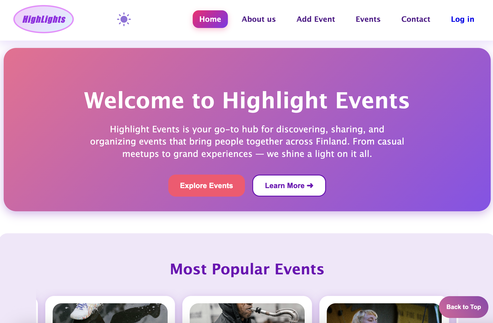

# 🌟 Events App – Highlight Events 

This web app started as a team project at Business College Helsinki. I decided to finish it on my own, keeping the parts I built and adding new features myself. The app is about discovering and managing local events all around Finland.
Users can explore, add, edit and delete events, with all changes saved to a database. It has several other features like dark mode, weather info, maps for event locations, a read more button, emoji icons for event types, calendar view and multiple ways to search or sort events. 
  

## 🌐 Live Demo
[**Events App on Vercel**](https://events-app-fawn.vercel.app/)

Check out how the event tickets work:  
[Demo on YouTube](https://youtu.be/0NzhdpnYPQQ)

## 🚀 Features

* 🔍 Search & Filter – Find events by name location or category  
*  🗓️ Calendar & List Views – Switch between calendar or list layout  
*  🧠 Sorting – Sort by price or name (A–Z Z–A)  
*  🖼️ Event Details – View full details add edit and delete events  
*  🌗 Dark & Light Mode – Toggle theme. Saved in local storage  
*  ⭐ Favorite Events – Save favorites locally in local storage
*  📱 Mobile-Friendly Design – Responsive layout
*   📜 Back to Top Button – Easy scroll back
*   🎠 Popular Events Slider – Scrollable slider for popular events
* ⏳ Loading Indicators – On multiple pages using React Spinners
* ☁️ Weather Display – Real time weather information for event locations via external API
* 🗺️ Map Display – Google Maps for event locations
*   Working on: CSS, User Authentication

______________________

## 🛠️ Tech Stack
### 🖥️  Frontend
* React
* CSS

### 🖥️ Backend
* Laravel 
* MySQL 

________

## Setup Guide

### 📦 Clone the Repository
- git clone https://github.com/HuttunenBe/eventsApp.git
- cd eventsApp

### 🔧 Laravel Setup 
- composer install
- cp .env.example .env
- php artisan key:generate

🛠 MySQL Database Setup
1. Create a MySQL database 
2. Update the .env file with your credentials:

* DB_CONNECTION=mysql
* DB_HOST=127.0.0.1
* DB_PORT=3306
* DB_DATABASE=your_db
* DB_USERNAME=your_username
* DB_PASSWORD=your_password

Run migrations:
- php artisan migrate
- php artisan config:clear
- php artisan serve

### ⚙️ CORS Configuration (Laravel)
* In cors.php file allowed origin add your own React URL:
    'allowed_origins' => [
        'http://localhost:5176'
    ]<php>

After run:
* php artisan config:clear

### ⚛️ React Setup 
* npm install
* npm run dev

### 🌍 React .env Setup
* Create a .env file in the root of your React app:
* Add your Laravel URL: VITE_BASE_URL=http://127.0.0.1:8000/

### ➕ React Packages
* npm install axios
* npm install react-spinners
* npm install react-toggle-dark-mode
* npm install react-scroll-to-top
* npm install @fullcalendar/react @fullcalendar/daygrid
* npm install @fullcalendar/timegrid @fullcalendar/interaction
